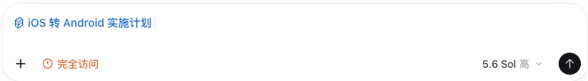
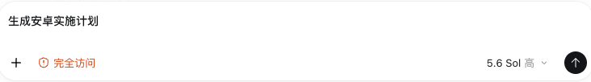
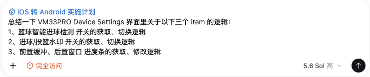
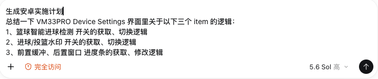
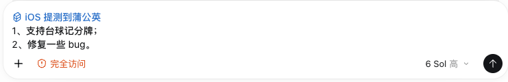
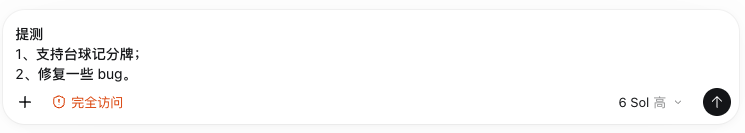
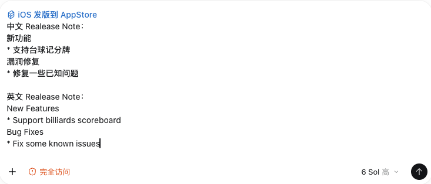
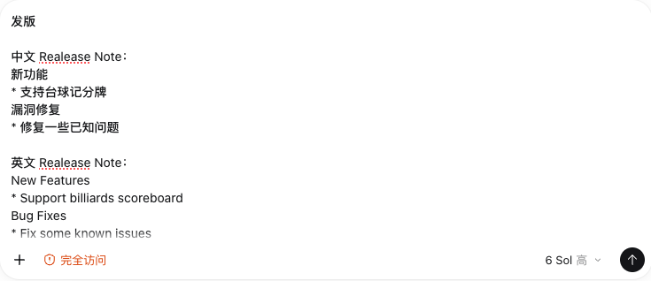

## 1️⃣【写 UI 阶段】写静态 UI

我们编写了一个 `static-ui` Skill，以便直接在 Codex 里通过显示调用或意图识别的方式触发这个 Skill 来实现 Figma 设计稿。

## 2️⃣【写逻辑阶段】iOS、Android 逻辑互转（包含业务逻辑、UI 逻辑等）

我们编写了一个 `ios-to-android-plan` Skill，以便直接在 Codex 里通过显示调用或意图识别的方式触发这个 Skill 来根据 iOS 实现生成 Android 实施计划，另外一个 `android-to-ios-plan` Skill 同理。

* 如果没有具体的提示词，则会把当前会话内所有落地的需求生成安卓实施计划

* 如果有具体的提示词，则只把具体的逻辑生成安卓实施计划

## 3️⃣【反推 PRD 阶段】一键反推 PRD + 通知企微群

我们编写了一个 reverse-prd Skill，以便直接在 Codex 里通过显示调用或意图识别的方式触发这个 Skill 来发起反推 PRD + 通知企微群。

* 如果用户没有输入其它具体的提示词，则把当前会话内所有落地的需求生成 prd

* 如果用户有输入其它具体的提示词，则根据提示词搜索项目内的相关功能再生成 prd

* 如果用户明确要求生成本地文档，那就先把文档保存在本地而不要上传到飞书云文档，上传到飞书云文档应该发生在用户没有明确要求生成本地文档时（一个大功能可能分成好几个小功能，分成多个会话实现，因此可以在一个会话里先精准总结当前小功能）

* 如果用户发了多份文档，那么会把这多份文档里的内容整合梳理成一份完整的 prd 再上传到飞书云文档并发送企微通知（把多个小功能的 prd 整合成一份完整的 prd）

## 4️⃣【提测阶段】iOS、Android 提测蒲公英 + 企微通知

我们编写了一个 `pgyer-ios` Skill，以便直接在 Codex 里通过显示调用或意图识别的方式触发这个 Skill 来发起一键打包 + 上传蒲公英 + 通知企微，而不用每次都去终端里敲命令，另外一个 `pgyer-android` Skill 同理。

## 5️⃣【改 BUG 阶段】一键改 BUG + 自动提交 + 自动修改飞书状态和添加评论

我们编写了一个 `bug-fix` Skill，以便直接在 Codex 里通过显示调用或意图识别的方式触发这个 Skill 来发起一键改 BUG。

## 6️⃣【发版阶段】一键打包 + 上传 App Store Connect

我们编写了一个 `app-store-ios` Skill，以便直接在 Codex 里通过显示调用或意图识别的方式触发这个 Skill 来发起一键打包 + 上传 App Store Connect，而不用每次都去终端里敲命令，另外一个 `app-store-android` Skill 同理。`为了确保提审版本信息没有错误，我们没有设计自动提交审核，还是由人工发起提交审核。`

