## 一、静态 UI

#### 方式一：Figma 官方插件 = Figma MCP Server + Figma Skill

###### 1、安装 Figma 官方插件

* 1️⃣ [参考文档：Codex and Figma: Set up the MCP server](https://help.figma.com/hc/en-us/articles/39888629089175-Codex-and-Figma-Set-up-the-MCP-server#h_01KPPFC952S5ZRG6KQCTVRAKCG)

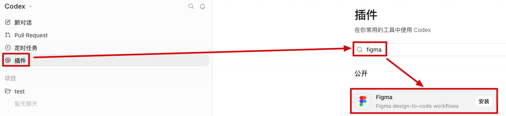

* 2️⃣ 安装完成后，可以看到这个插件里打包了 1 个 Figma MCP Server 和 12 个 Figma Skill。Figma MCP Server 里的工具用来访问 Figma 远程服务器上的数据，Figma Skill 则用来给 Codex 提供官方预置的 SOP 以便它知道该如何更好地使用 Figma MCP Server 里的工具（如果我们的需求仅仅是“读取 Figma 设计稿生成代码”，那只需要保留“Figma Design to Code”这一个 Skill 即可，这个 Skill 就负责告诉 Codex 该如何从 Figma 设计稿中获取界面结构、控件属性和图片资源，并将其转换成代码）

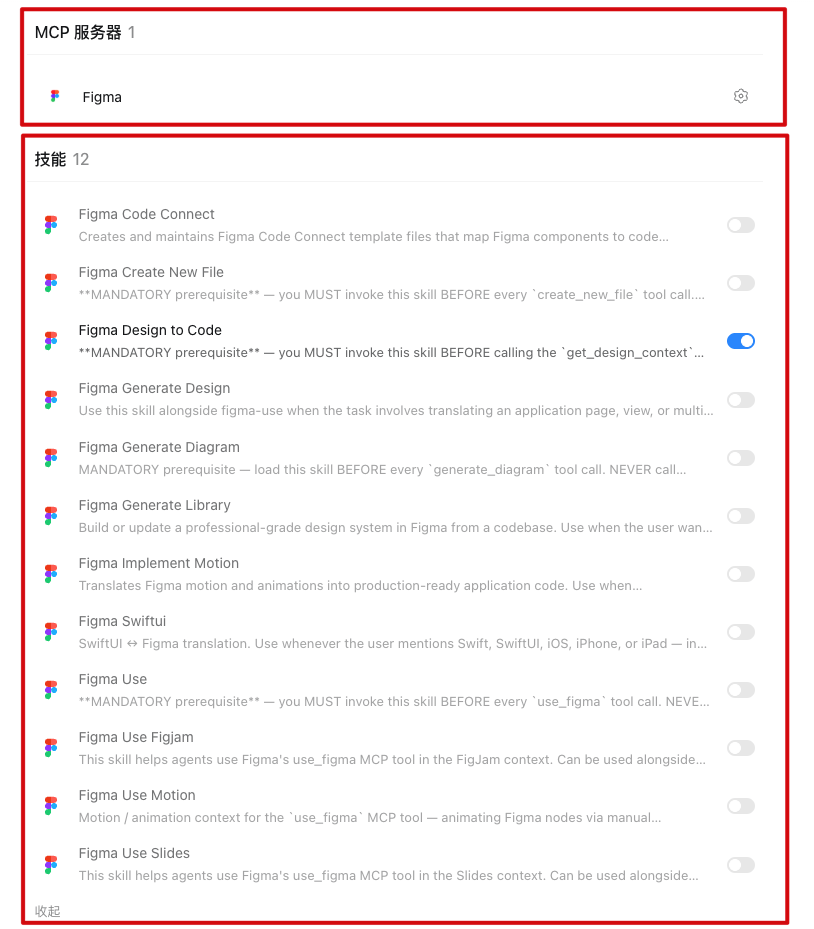

###### 2、使用 Figma 官方插件

* 1️⃣ [参考文档：Guide to the Figma MCP server](https://help.figma.com/hc/en-us/articles/32132100833559-Guide-to-the-Figma-MCP-server)，选中要实现的界面或控件，右键选择“Copy link to selection”，会复制出一个 URL

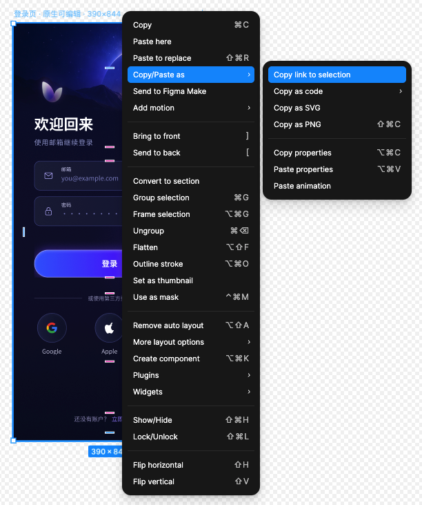

* 2️⃣ 把 URL 和类似的提示词发给 Codex 即可

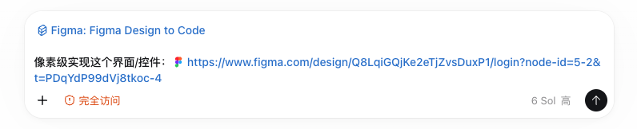

###### 3、Figma 官方插件的优劣

优势：对设计稿的还原比较精准，Codex 实现后我们再对极少数细节微调一下就搞定了

劣势：额度太少了，免费版一个月只能调用 20 次 MCP Server 里的工具，付费版一个月 500 块也才一天 200 次

#### 方式二：图片 + CSS 样式 + 图片资源

###### 1、使用图片 + CSS 样式 + 图片资源

* 1️⃣ 选中要实现的界面或控件，右键选择“Copy as PNG”，会复制出一张 1x 图，图片的作用在于提供最终视觉效果，以便 Codex 能参照界面结构

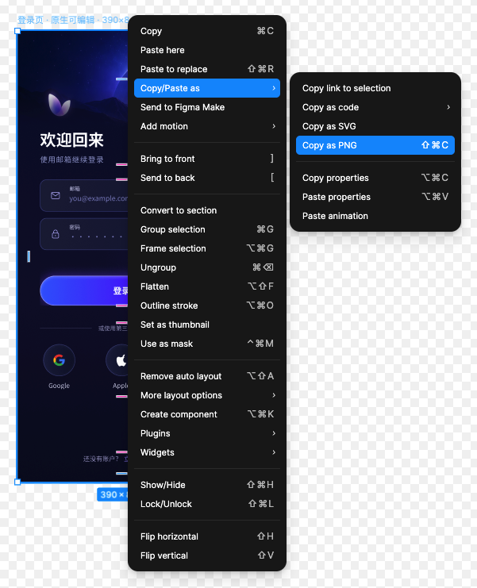

* 2️⃣ 选中要实现的界面或控件，右键选择“Copy as code - CSS（all layers）”，会复制出一堆 CSS 样式，CSS 样式的作用在于提供设计参数，以便 Codex 能参照控件属性

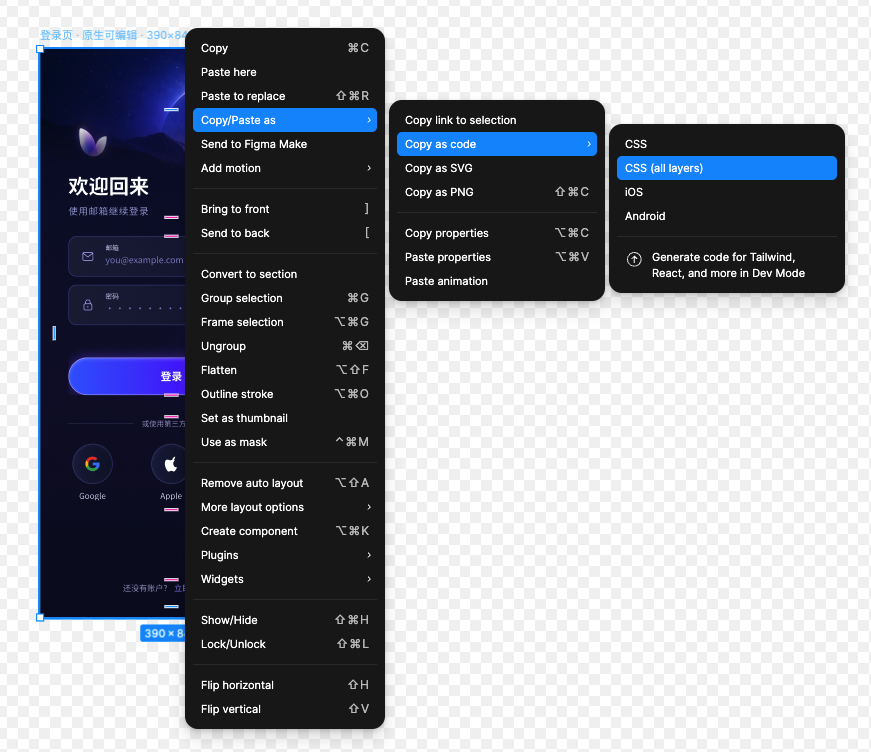

* 3️⃣ 我们还需要手动把当前界面或控件所用到的图片资源都下载下来，提前放入项目中

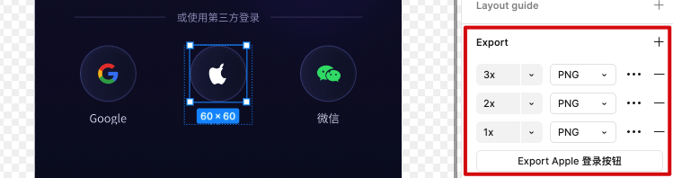

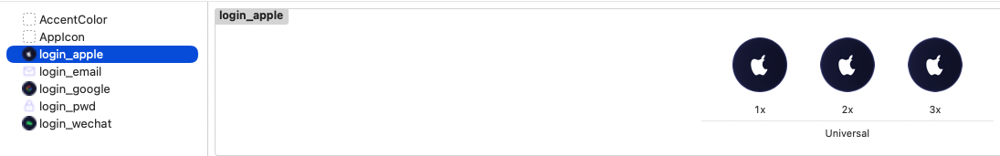

* 4️⃣ 把图片、CSS 样式和类似的提示词发给 Codex 即可

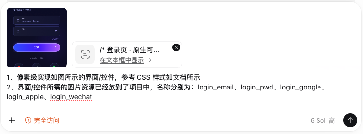

###### 2、图片 + CSS 样式 + 图片资源的优劣

优势：不消耗任何 Figma 额度，无限使用

劣势：对设计稿的还原不是那么精准，Codex 实现后我们需要微调的细节可能较多，此外我们需要手动处理图片资源

#### 方式三（推荐）：开源库 [figma-mcp-bridge](https://github.com/gethopp/figma-mcp-bridge)

###### 1、使用开源库 figma-mcp-bridge

* 1️⃣ 给 Codex 安装用户级 gethopp MCP Server

终端执行命令开始安装

```shell
# codex mcp add：给 Codex 安装用户级 MCP Server
# figma-mcp-bridge：给 MCP Server 起一个名字
# npx -y：自动运行 npm 包，首次使用时按需下载
# @gethopp/figma-mcp-bridge：gethopp 发布的 npm 包
codex mcp add figma-mcp-bridge -- npx -y @gethopp/figma-mcp-bridge
```

重启 Codex，对话框输入 / 查询安装状态

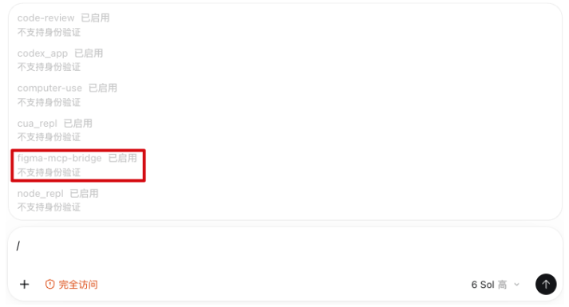

* 2️⃣ 下载 Figma Desktop 版本，因为 Figma Browser 版本不支持导入插件

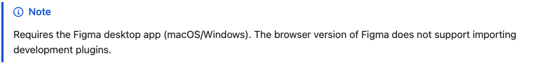

* 3️⃣ 给 Figma Desktop 导入插件

从 [latest release](https://github.com/gethopp/figma-mcp-bridge/releases) 页面下载最新插件，解压后保存在电脑本地

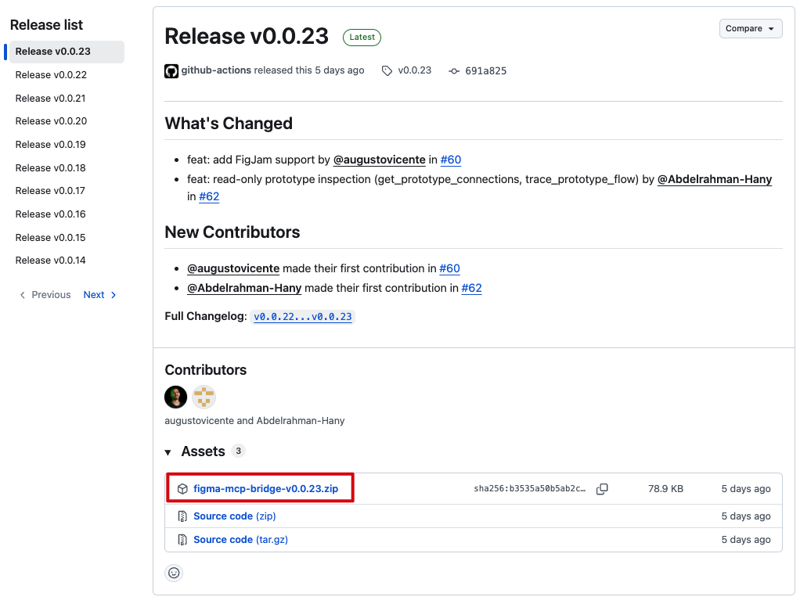

在 Figma Desktop 中依次点击 `Plugins > Development > Import plugin from manifest` ，并选择 `plugin/` 夹中的 `manifest.json` 文件

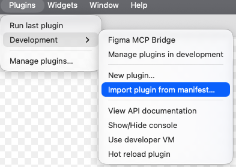

* 4️⃣ **在 Figma Desktop 中打开某个设计文件，然后启动插件并一直保持启动状态，**插件会通过 WebSocket 与 MCP Server 保持连接（多份设计文件可以对应多个插件，gethopp 支持通过 fileKey 区分当前连接的文件）

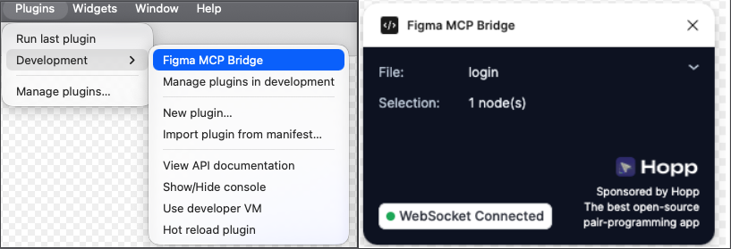

* 5️⃣ 选中要实现的界面或控件，右键选择“Copy link to selection”，会复制出一个 URL


* 6️⃣ 让 Codex 实现

我们编写了一个 static-ui Skill，以便直接在 Codex 里通过显示调用或意图识别的方式触发这个 Skill 来实现 Figma 设计稿。


## 二、动态 UI

目前没有一个类似“Figma MCP 生成动态逻辑”这样的成熟方案，所以一般都是通过 Figma MCP 实现静态 UI，然后我们自己跟 Codex 聊天来根据需求实现动态 UI——比如界面内的控件状态切换和动画、界面跳转等。 
