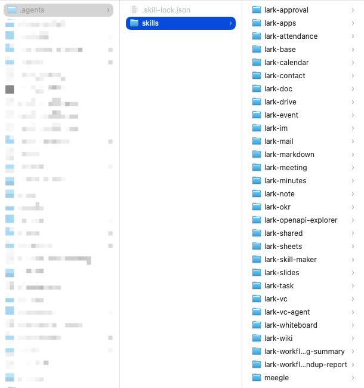
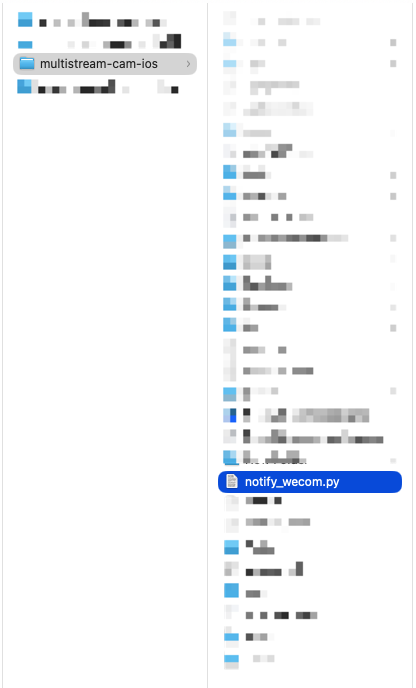
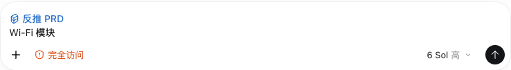
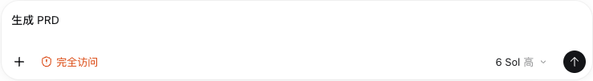
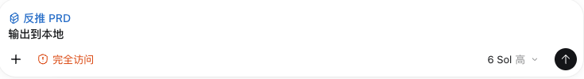
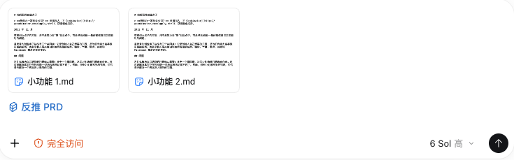

## 一、安装飞书官方 [Lark CLI](https://github.com/larksuite/cli)（操作飞书文档、知识库、云盘）

终端执行如下命令安装，期间终端会输出配置地址或二维码，用浏览器打开配置地址或手机飞书扫码，使用文档所在的飞书账号完成配置；期间终端还会输出授权地址，用浏览器打开授权地址，使用文档所在的飞书账号完成授权，授权完成后回到终端，等待安装命令结束

```shell
npx @larksuite/cli@latest install
```

终端执行如下命令查看版本

```shell
lark-cli --version

# 期望输出：
# lark-cli version 1.0.97
```

终端执行如下命令查看飞书账号授权状态

```shell
meegle auth status --format json

# 期望输出：
# 输出中应包含成功状态和已授权权限
```

如果将来飞书授权过期了，终端执行如下命令获取 json 里的 verification_url 重新授权

```shell
lark-cli auth login \
  --scope "wiki:space:retrieve" \
  --no-wait \
  --json
```

注意：安装完成后，确认下本机上有没有成功安装一堆 lark Skill



## 二、编写飞书文档上传成功后通知企微的脚本（iOS、安卓共用）

```py
#------ notify_wecom.py ------#

#!/usr/bin/env python3
"""Send reusable notifications to a WeCom group robot.
不同项目需要修改 DEFAULT_WECOM_WEBHOOK 和 DEFAULT_MENTIONED_MOBILES
"""

from __future__ import annotations

import argparse
import json
import os
import sys
from typing import Callable, Iterable
from urllib.error import HTTPError, URLError
from urllib.request import Request, urlopen


# Edit these defaults for the target WeCom group. The environment variables
# override them in CI. Keep real webhook URLs out of public repositories.
DEFAULT_WECOM_WEBHOOK = "https://qyapi.weixin.qq.com/cgi-bin/webhook/send?key=01c7f32c"
DEFAULT_MENTIONED_MOBILES: tuple[str, ...] = (
    "手机号 1",
    "手机号 2"
)

WECOM_WEBHOOK = os.environ.get("WECOM_WEBHOOK", DEFAULT_WECOM_WEBHOOK)
if "WECOM_MENTIONED_MOBILES" in os.environ:
    MENTIONED_MOBILES = tuple(
        mobile.strip()
        for mobile in os.environ["WECOM_MENTIONED_MOBILES"].split(",")
        if mobile.strip()
    )
else:
    MENTIONED_MOBILES = DEFAULT_MENTIONED_MOBILES

DEFAULT_TIMEOUT_SECONDS = 15


class NotificationError(RuntimeError):
    """Raised when a WeCom notification cannot be delivered or is rejected."""


def build_feishu_prd_message(
    title: str,
    url: str,
    mentioned_mobiles: Iterable[str] = MENTIONED_MOBILES,
) -> dict:
    """Build the WeCom text payload for a verified Feishu PRD document."""

    title = title.strip()
    url = url.strip()
    if not title:
        raise NotificationError("Feishu PRD title is empty")
    if not url:
        raise NotificationError("Feishu PRD URL is empty")

    mobiles = tuple(mobile.strip() for mobile in mentioned_mobiles if mobile.strip())
    content = f"《{title}》：{url}"

    return {
        "msgtype": "text",
        "text": {
            "content": content,
            "mentioned_mobile_list": list(mobiles),
        },
    }


def send_payload(
    payload: dict,
    webhook: str = WECOM_WEBHOOK,
    timeout: int = DEFAULT_TIMEOUT_SECONDS,
) -> dict:
    """POST one payload to the configured WeCom robot and validate its reply."""

    webhook = webhook.strip()
    if not webhook:
        raise NotificationError(
            "WeCom webhook is not configured; edit WECOM_WEBHOOK or set the "
            "WECOM_WEBHOOK environment variable"
        )

    request = Request(
        webhook,
        data=json.dumps(payload, ensure_ascii=False).encode("utf-8"),
        headers={"Content-Type": "application/json"},
        method="POST",
    )
    try:
        with urlopen(request, timeout=timeout) as response:
            response_body = response.read().decode("utf-8")
    except HTTPError as error:
        raise NotificationError(f"WeCom HTTP error {error.code}") from error
    except URLError as error:
        raise NotificationError(f"WeCom network error: {error.reason}") from error

    try:
        result = json.loads(response_body)
    except json.JSONDecodeError as error:
        raise NotificationError("WeCom returned invalid JSON") from error

    if result.get("errcode") != 0:
        raise NotificationError(
            f"WeCom rejected notification: {result.get('errmsg', 'unknown error')}"
        )
    return result


def push_feishu_prd(
    title: str,
    url: str,
    mentioned_mobiles: Iterable[str] = MENTIONED_MOBILES,
    webhook: str = WECOM_WEBHOOK,
) -> dict:
    """Push a Feishu PRD title and link, then @ configured mobile numbers."""

    payload = build_feishu_prd_message(
        title=title,
        url=url,
        mentioned_mobiles=mentioned_mobiles,
    )
    return send_payload(payload, webhook=webhook)


# Add future notification methods here without changing the PRD workflow.
HANDLERS: dict[str, Callable[..., dict]] = {
    "feishu-prd": push_feishu_prd,
}


def _build_parser() -> argparse.ArgumentParser:
    parser = argparse.ArgumentParser(description="Send notifications to a WeCom group robot")
    subparsers = parser.add_subparsers(dest="method", required=True)

    feishu_prd = subparsers.add_parser(
        "feishu-prd", help="push a verified Feishu PRD title and link"
    )
    feishu_prd.add_argument("--title", required=True)
    feishu_prd.add_argument("--url", required=True)
    return parser


def main(argv: list[str] | None = None) -> int:
    args = _build_parser().parse_args(argv)
    try:
        HANDLERS[args.method](title=args.title, url=args.url)
    except NotificationError as error:
        print(f"notify_wecom: {error}", file=sys.stderr)
        return 1
    print(f"notify_wecom: sent {args.method}")
    return 0


if __name__ == "__main__":
    raise SystemExit(main())
```



## 三、Codex 里一键反推 PRD + 通知企微群

我们编写了一个 reverse-prd Skill，以便直接在 Codex 里通过显示调用或意图识别的方式触发这个 Skill 来发起反推 PRD + 通知企微群。

* 如果用户没有输入其它具体的提示词，则把当前会话内所有落地的需求生成 prd

* 如果用户有输入其它具体的提示词，则根据提示词搜索项目内的相关功能再生成 prd

* 如果用户明确要求生成本地文档，那就先把文档保存在本地而不要上传到飞书云文档，上传到飞书云文档应该发生在用户没有明确要求生成本地文档时（一个大功能可能分成好几个小功能，分成多个会话实现，因此可以在一个会话里先精准总结当前小功能）

* 如果用户发了多份文档，那么会把这多份文档里的内容整合梳理成一份完整的 prd 再上传到飞书云文档并发送企微通知（把多个小功能的 prd 整合成一份完整的 prd）








