## 一、配置 Google Play 认证

#### 1、从 Google Cloud 控制台首页选择项目

> **可跳过：** 已进入正确的 Cloud 项目时，可跳过选择项目；已有项目时直接选择，不必新建。

打开 [Google Cloud 控制台](https://console.cloud.google.com/)，登录有项目管理权限的 Google 账号。点击左上角项目名称，选择用于发布的 Cloud 项目；没有项目时，在项目选择窗口点击「新建项目」，创建后切换进去。

下图以 NearStream 项目为例。自己配置时选择自己的项目；后面的 API 和服务账号都在同一个 Cloud 项目中操作。

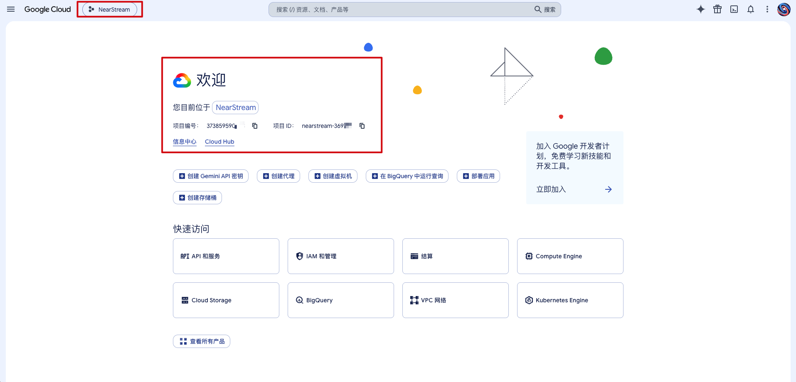

#### 2、启用 Google Play Android Developer API

> **可跳过：** 服务账号所在 Cloud 项目已启用此 API。未启用时仍需完成本步。

从首页下方「快速访问」点击「API 和服务」，进入左侧「库 / API 库」。也可以通过左上角导航菜单进入「API 和服务 → 库」。搜索 **Google Play Android Developer API**，点击同名结果。

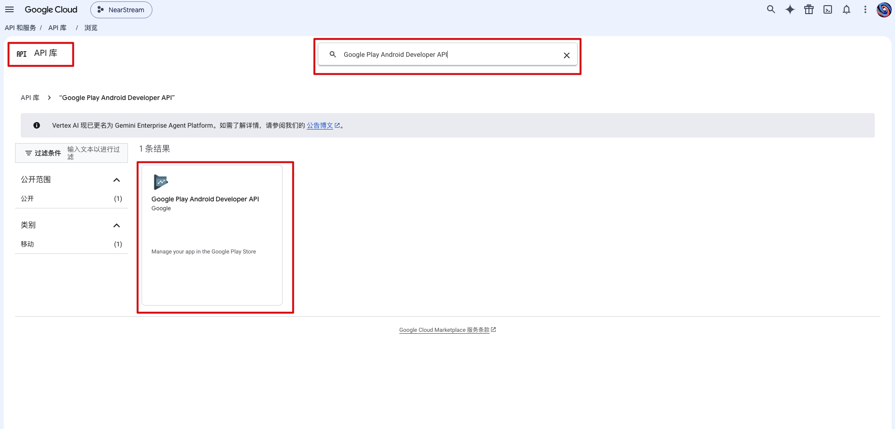

进入详情页后点击「启用」。如果已显示「API 已启用」和「管理」，说明这一步已经完成，不用重复操作。注意服务名称是 `androidpublisher.googleapis.com`。

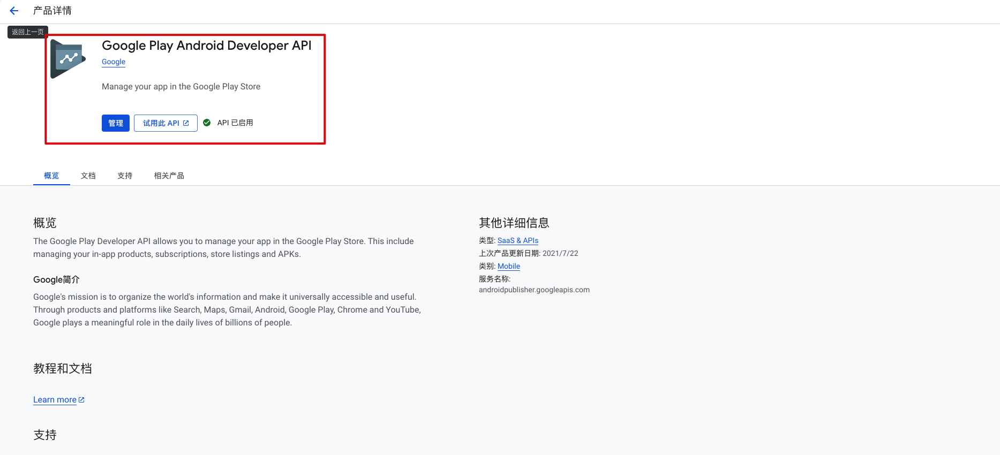

#### 3、创建服务账号

> **可跳过：**已有要复用的服务账号。多个 App 可以共用一个服务账号和同一 JSON。邮箱中的「项目 ID」只是创建该服务账号的 Cloud 项目 ID，不限制它只能发布一个 App，无需每个 Android 项目重新创建账号和密钥。

回到控制台首页，从「快速访问 → IAM 和管理」进入，再点击左侧「服务账号」；也可以通过导航菜单进入「IAM 和管理 → 服务账号」。点击上方「创建服务账号」。

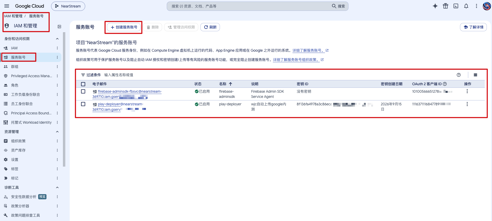

填写下面的信息：

- **服务账号名称**：例如 `play-deployer`。

- **服务账号 ID**：可沿用自动生成的值；如果该 ID 已占用，换一个名称。

- **服务账号说明**：例如「Android Google Play 上传」。

仅用于 Play 发布时，下面的 Cloud「权限」和「具有访问权限的主体」可以留空，点击「创建并关闭」完成；有些界面对应按钮叫「完成」。Play 应用的发布权限在后面的 Play Console 中配置，不需要给这个服务账号授予 Cloud Owner / Editor。

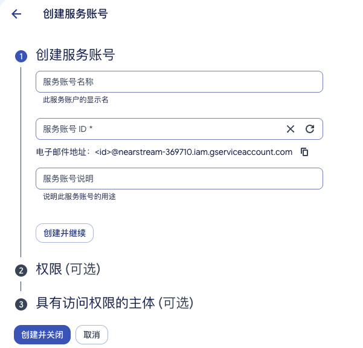

创建后复制服务账号的**完整邮箱**，形式为 `play-deployer@你的项目ID.iam.gserviceaccount.com`，后续会用到。已有用于发布的服务账号时，可以直接打开该账号，不必再新建。[官方创建说明](https://docs.cloud.google.com/iam/docs/service-accounts-create)

后续可以在 Play Console 的「用户和权限」中找到这个服务邮箱，进入 **App permissions → Add app**，添加其他需要发布的 App，并分别授予所需发布权限。各 Android 项目配置同一份 JSON 的路径即可。[官方权限说明](https://support.google.com/googleplay/android-developer/answer/9844686?hl=en)

#### 4、创建并下载 JSON 私钥

> **可跳过：** 手上已有该服务账号的可用 JSON 文件，直接进入后续步骤。后台仅显示有密钥，但找不到本地 JSON 文件时，不能跳过本步。

在服务账号列表中点击刚创建的账号邮箱，打开「密钥」标签，点击「添加键 / 添加密钥 → 创建新密钥」。

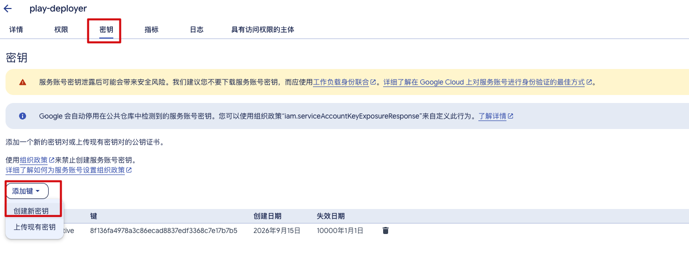

在弹窗中选择 **JSON**，再点击「创建」，浏览器会下载一个 `.json` 文件。下载得到的这个文件就是 Skill 需要的认证文件。**JSON** **私钥****只在创建时下载一次，旧密钥不能重新下载。** 已有可用 JSON 就直接使用；如果文件丢失，需要创建新密钥并由管理员安排旧密钥的处理。若提示组织政策禁止创建密钥，联系 Cloud 管理员处理。[官方密钥说明](https://docs.cloud.google.com/iam/docs/keys-create-delete)

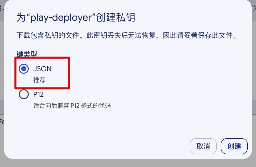

#### 5、在 Google Play Console 授权

> **可跳过：** 同一服务账号已拥有当前目标 App 所需的发布权限。**复用账号发布一个尚未授权的新 App 时，本步不能跳过**，需要给现有账号添加该 App 的权限

打开 [Google Play Console](https://play.google.com/console/)，切到目标应用所属的开发者账号。若当前在某个应用内，先点击「所有应用」返回账号首页，再进入左侧「用户和权限 / Users and permissions」。**已有这个服务邮箱时，点击其「管理 / Manage」，直接添加目标 App；尚未加入这个服务邮箱时，点击「邀请新用户 / Invite new users」。** 这一步需要账号所有者或有用户管理权限的管理员操作。

邮箱填之前复制的**服务账号邮箱**，不是你登录后台的个人 Gmail。选择「应用权限 → 添加应用」，核对包名后选中要发布的应用。

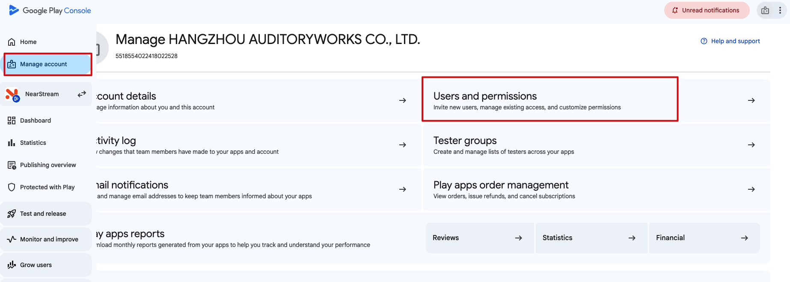

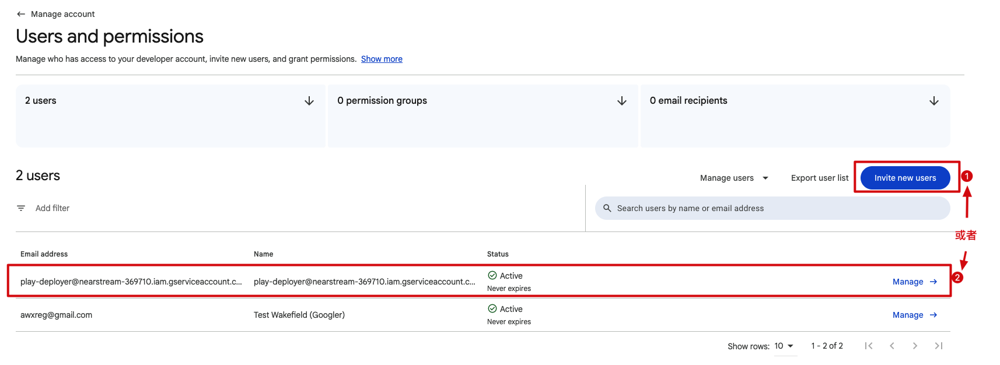

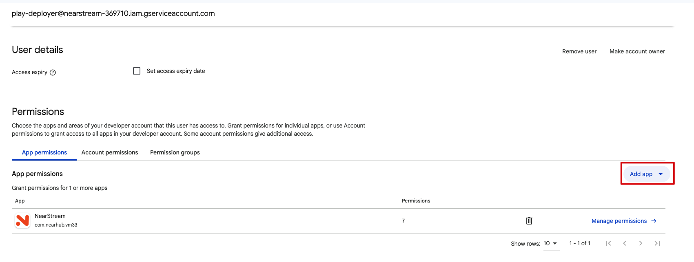

为该应用配置以下权限，再点击「应用 / Apply」。首次邀请服务账号时，最后点击「邀请用户 / Invite user」；修改已有账号时，按页面提示保存权限变更：

- **查看应用信息（****只读****） / View app information (****read-only****)**。

- **将应用发布到测试轨道 / Release apps to testing tracks**：覆盖上传产物和编辑未上线版本更新说明的操作。

- **发布到正式版、排除设备和使用 Play 应用签名 / Release to production, exclude devices, and use Play App Signing**：用于创建和编辑 Production 版本。

只选择需要发布的应用即可，无需为这个上传流程授予管理员、财务或订单权限。下图展示发布权限所在区域，具体中文文案以你的后台为准。

**Production 权限本身允许正式发布；本 Skill 通过固定上传 `draft` 草稿来保留后台人工发布步骤，并不是 Google 提供了“只能传草稿”的独立权限。**

完成后，服务账号就能按所授予的权限访问目标应用。当前官方流程不再要求把 Play 开发者账号与 Cloud 项目做旧式“项目关联”。[官方认证配置](https://developers.google.com/android-publisher/getting_started) · [官方权限说明](https://support.google.com/googleplay/android-developer/answer/9844686?hl=zh-Hans)

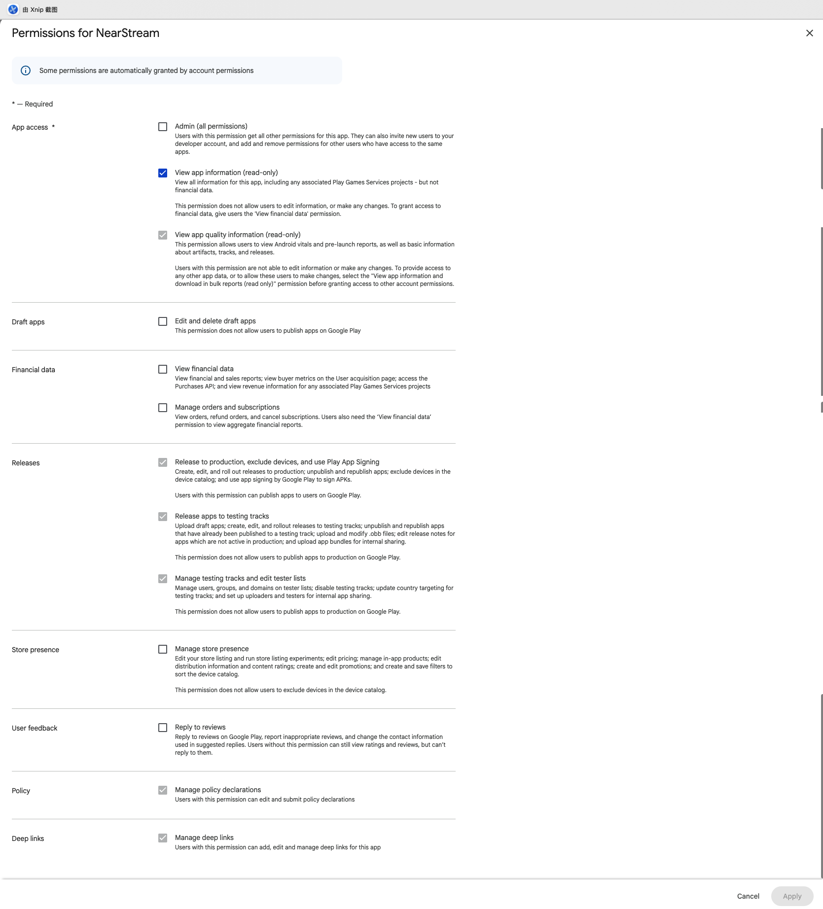

#### 6、把文件放进项目

> 当前 Android 项目已配置正确的 JSON 路径，且文件可读取。共用其他位置的 JSON 时，只需配置该路径，不必再复制一份到 fastlane/。

将刚下载的文件改名为 `play-service-account.json`，放到当前 Android 项目的 `fastlane/` 目录。这里使用的是**服务账号****私钥** **JSON**，不是 Firebase 的 `google-services.json`；JKS 继续沿用项目原位置。

准备有权访问目标应用的服务账号 JSON，将其放到当前项目：

```
你的 Android 项目/
└── fastlane/
    └── play-service-account.json
```

## 二、Codex 里发起一键打包 + 上传 App Store Connect

我们编写了一个 app-store-ios Skill，以便直接在 Codex 里通过显示调用或意图识别的方式触发这个 Skill 来发起一键打包 + 上传 App Store Connect，而不用每次都去终端里敲命令。`为了确保提审版本信息没有错误，我们没有设计自动提交审核，还是由人工发起提交审核。`


