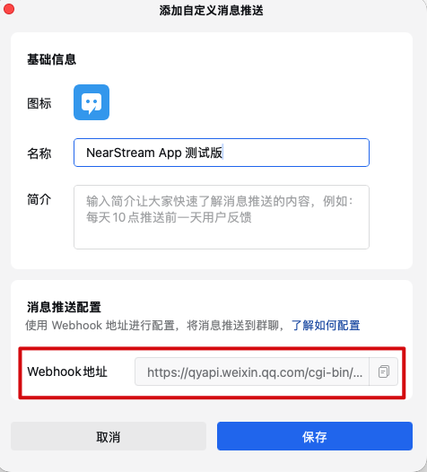
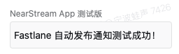
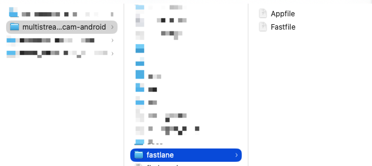
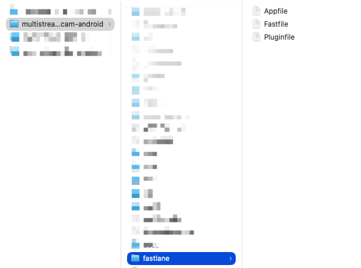
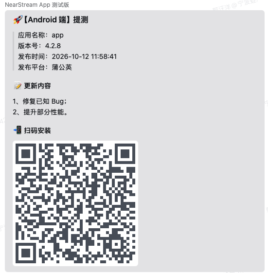
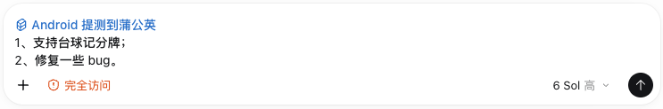
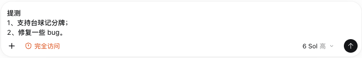
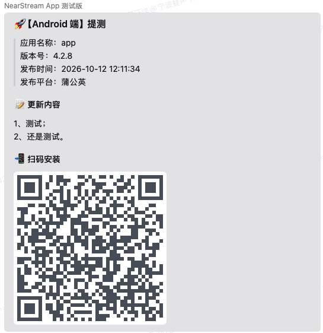

## 一、配置企微群聊消息推送

我们希望在打包提测后能自动往企微群里推送一条消息通知相关人员，而不用每次人工通知。

#### 1、获取企微群聊消息推送的 Webhook 地址

* 打开企微

* 打开某个群聊

* 点击右上角的群聊设置

* 找到消息推送

* 添加消息推送

* 复制它的 Webhook 地址



#### 2、验证能否通过 Webhook 地址给企微群聊推送消息在需要验证时执行以下命令，它会向配置的群发送一条测试消息：

终端执行以下命令验证

```shell
curl '你的 Webhook 地址' \
  -H 'Content-Type: application/json' \
  -d '{
    "msgtype": "text",
    "text": {
      "content": "Fastlane 自动发布通知测试成功！"
    }
  }'
```

执行后，企微群聊成功收到推送



## 二、安装 fastlane

终端执行以下命令安装 fastlane

```shell
brew install fastlane
```

终端执行以下命令查看 fastlane 版本

```shell
fastlane --version
```

## 三、配置 fastlane

#### 1、初始化 fastlane

cd 到项目根目录，终端执行以下命令初始化 fastlane

```shell
fastlane init
```

Package Name：输入包名，回车

Path to the json secret file：直接回车

Download existing metadata and setup metadata management?：n，回车

然后一路敲回车

执行结束后，项目根目录下会自动生成一个 fastlane 文件夹



#### 2、编辑 fastlane 文件

```ruby
#------ Appfile ------#

# ============================== 
# 1、App 的包名
# 哪里找？项目根目录 → app 目录 → build.gradle → applicationId
# ============================== 
package_name("com.nearhub.vm33")

# ============================== 
# 2、GP 发布凭据
# 哪里找？登录 Apple Developer 网站：Account → Membership Details → Team ID（10 位的字母数字组合）
# Path to the json secret file - Follow https://docs.fastlane.tools/actions/supply/#setup to get one
# ============================== 
json_key_file("")
```

```ruby
#------ Fastfile ------#
# 不同项目需要修改【项目基础配置】的以下内容：
# 1、PGYER_API_KEY：登录蒲公英 > 账号 > API 信息 > API Key
# 2、WECOM_WEBHOOK：企业微信群机器人 Webhook 地址
# 3、TESTER_MOBILES：需要 @ 的人员手机号
#
# 注意：
# 1、Android 项目需要提前配置好 Release 签名
# 2、确保 ./gradlew assembleRelease 可以正常生成 APK

default_platform(:android)

platform :android do

  # ==============================
  # 1、项目基础配置
  # ==============================

  # 项目根目录
  PROJECT_ROOT = File.expand_path("..", __dir__)

  # Android App 模块名称
  ANDROID_MODULE = "app"
  
  # 输出包的渠道
  # normal：普通渠道，输出 apk，如上传蒲公英
  # google：Google 渠道，输出 apk 或 aab，取决于构建命令
  PRODUCT_FLAVOR = "normal"

  # 打包类型
  BUILD_VARIANT = "Release"

  # PGYER_API_KEY
  # 推荐通过环境变量配置，避免密钥提交到 Git
  PGYER_API_KEY = "99d5f2bd5fca6f06478425d427613e74"

  # 企微群聊消息推送的 Webhook 地址
  WECOM_WEBHOOK = "https://qyapi.weixin.qq.com/cgi-bin/webhook/send?key=01c7f32c-525e-4540-96e4-6c8dda8ac4bb"

  # 需要 @ 的人员手机号
  TESTER_MOBILES = [
    "手机号 1",
    "手机号 2"
  ]


  # ==============================
  # 2、打包 APK
  # ==============================

  # 描述一下 fastlane 正在做什么
  desc "Build Android APK"

  # 将来执行 fastlane build 命令即可开始“打包 APK”
  lane :build do

    # 终端里会打印这条信息
    UI.message("开始构建 Android 安装包")

    # ------------------------------
    # 第一步：清理之前的构建缓存
    # ------------------------------
    gradle(
      task: "clean",
      project_dir: PROJECT_ROOT
    )


    # ------------------------------
    # 第二步：构建 Release APK
    # ------------------------------
    gradle(
      task: "assemble",
      flavor: PRODUCT_FLAVOR,
      build_type: BUILD_VARIANT,
      project_dir: PROJECT_ROOT,
      flags: "--stacktrace"
    )


    # ------------------------------
    # 第三步：检查 APK 是否生成
    # ------------------------------
    # 获取实际生成的 APK 路径
    apk_path = lane_context[
      SharedValues::GRADLE_APK_OUTPUT_PATH
    ]    

    # 检查 APK 是否存在
    if apk_path.nil? || !File.exist?(apk_path)
      UI.user_error!("APK 不存在，请检查 Gradle 构建结果")
    end


    # ------------------------------
    # 第四步：检查 APK 是否为空
    # ------------------------------
    if File.size(apk_path) == 0
      UI.user_error!("APK 文件为空，打包失败")
    end


    # ------------------------------
    # 第五步：输出构建结果
    # ------------------------------
    UI.success("Android 打包成功")
    UI.message("APK 路径：#{apk_path}")
    UI.message(
      "APK 大小：#{(File.size(apk_path) / 1024.0 / 1024.0).round(2)} MB"
    )

    # 返回 APK 路径
    apk_path
  end


  # ==============================
  # 3、上传 APK
  # ==============================

  # 描述一下 fastlane 正在做什么
  desc "Upload existing APK to Pgyer"

  # 将来执行 fastlane upload 命令即可开始“上传 APK”
  # options 是 Ruby 的 Hash 类型，可以通过终端传递参数
  #
  # 例如：
  # fastlane upload releaseNote:"1、修复已知Bug；\n2、提升部分性能。"

  lane :upload do |options|

    # 获取 APK 路径
    apk_path = options[:apk] || lane_context[
      SharedValues::GRADLE_APK_OUTPUT_PATH
    ]
    
    # 将相对路径转换为基于项目根目录的绝对路径
    if apk_path && !Pathname.new(apk_path).absolute?
      apk_path = File.expand_path(apk_path, PROJECT_ROOT)
    end

    # 检查 APK 是否存在
    if apk_path.nil? || !File.file?(apk_path)
      UI.user_error!(
        "APK 不存在：#{apk_path || '未指定 APK 路径'}"
      )
    end

    # 检查蒲公英 API Key
    if PGYER_API_KEY.nil? || PGYER_API_KEY.empty?
      UI.user_error!("请先配置 PGYER_API_KEY")
    end

    # 终端里会打印这条信息
    UI.message("开始上传蒲公英")

    # 获取更新说明
    release_note = (
      options[:releaseNote] || "Android 测试版本"
    ).gsub('\n', "  \n")


    # ------------------------------
    # 上传 APK 到蒲公英
    # ------------------------------

    result = pgyer(
      api_key: PGYER_API_KEY,
      apk: apk_path,
      update_description: release_note
    )

    UI.success("蒲公英上传成功")


    # ------------------------------
    # 检查上传结果
    # ------------------------------

    unless result.is_a?(Hash)
      UI.user_error!("蒲公英未返回有效的上传结果")
    end


    # ------------------------------
    # 输出上传信息
    # ------------------------------

    UI.message("蒲公英上传结果：")

    UI.message(
      "版本号：#{result['buildVersion'] || '未知'}"
    )

    UI.message(
      "Build 号：#{result['buildVersionNo'] || '未知'}"
    )

    UI.message(
      "二维码地址：#{result['buildQRCodeURL'] || '未知'}"
    )


    # 将完整上传结果返回给调用方
    # beta 可以获取下载地址、版本号、Build 号
    result

  end


  # ==============================
  # 4、企业微信群聊消息推送
  # ==============================

  # 描述一下 fastlane 正在做什么
  desc "Send release notification to WeCom"

  # 将来执行 fastlane notify 命令即可发起企微群聊消息推送
  #
  # 例如：
  # fastlane notify url:"https://www.pgyer.com/xxxx"
  #
  # 支持传入以下参数：
  # platform：发布平台（蒲公英 / 应用市场）
  # url：下载地址
  # qrcodeUrl：二维码地址
  # version：App 版本号
  # buildNumber：App Build 号
  # releaseNote：更新内容

  lane :notify do |options|

    # 引入 Ruby 标准库
    require "net/http"
    require "json"
    require "uri"

    # 检查 Webhook
    if WECOM_WEBHOOK.nil? || WECOM_WEBHOOK.empty?
      UI.user_error!("请先配置 WECOM_WEBHOOK")
    end

    # 获取发布平台
    publish_platform = options[:platform] || "蒲公英"

    # 获取下载地址
    download_url = options[:url]

    # 获取二维码地址
    qrcode_url = options[:qrcodeUrl]

    UI.message("二维码地址：#{qrcode_url}")

    # 判断二维码地址是否存在
    qrcode_markdown = if qrcode_url && !qrcode_url.empty?
      ""
    else
      ""
    end

    # 获取版本号
    version = options[:version] || "未知"

    # 获取更新说明
    release_note = (
      options[:releaseNote] || "Android 测试版本"
    ).gsub('\n', "  \n")

    # 获取发布时间
    publish_time = Time.now.strftime(
      "%Y-%m-%d %H:%M:%S"
    )


    # ------------------------------
    # 构造企业微信 Markdown 消息
    # ------------------------------

    content = <<~MARKDOWN
      ## 🚀【Android 端】提测

      > 应用名称：#{ANDROID_MODULE}
      > 版本号：#{version}
      > 发布时间：#{publish_time}
      > 发布平台：#{publish_platform}

      #### 📝 更新内容

      #{release_note}

      #### 📲 扫码安装

      #{qrcode_markdown}
    MARKDOWN


    # ------------------------------
    # 发送 HTTP 请求
    # ------------------------------

    # 将 Webhook 字符串转为 URI 对象
    uri = URI.parse(WECOM_WEBHOOK)

    # 创建 POST 请求
    request = Net::HTTP::Post.new(uri)

    # 设置请求类型
    request["Content-Type"] = "application/json"

    # 构造请求 Body
    request.body = {
      msgtype: "markdown_v2",
      markdown_v2: {
        content: content
      }
    }.to_json

    # 输出日志
    UI.message("开始发送企业微信群通知")

    # 发送请求
    response = Net::HTTP.start(
      uri.hostname,
      uri.port,
      use_ssl: true,
      open_timeout: 10,
      read_timeout: 15
    ) do |http|

      http.request(request)

    end


    # ------------------------------
    # 检查发送结果
    # ------------------------------

    # 检查 HTTP 状态码
    unless response.is_a?(Net::HTTPSuccess)
      UI.user_error!(
        "企业微信通知失败：HTTP #{response.code}"
      )
    end

    # 解析企业微信返回的数据
    result = JSON.parse(response.body)

    # 判断企业微信是否接收成功
    if result["errcode"] == 0

      UI.success("企业微信群通知发送成功")

    else

      UI.user_error!(
        "企业微信群通知失败：#{result['errmsg']}"
      )

    end


    # ------------------------------
    # @ 指定人员
    # ------------------------------

    # 如果没有配置手机号，则跳过 @ 通知
    if TESTER_MOBILES.empty?
      UI.message("未配置测试人员手机号，跳过 @ 通知")
      next
    end

    # 创建 POST 请求
    mention_request = Net::HTTP::Post.new(uri)

    # 设置请求类型
    mention_request["Content-Type"] = "application/json"

    # 构造请求 Body
    mention_request.body = {
      msgtype: "text",
      text: {
        content: "🚀 【Android 端】已提测，请及时安装测试。",
        mentioned_mobile_list: TESTER_MOBILES
      }
    }.to_json

    # 输出日志
    UI.message("开始 @ 指定人员")

    # 发送请求
    mention_response = Net::HTTP.start(
      uri.hostname,
      uri.port,
      use_ssl: true,
      open_timeout: 10,
      read_timeout: 15
    ) do |http|

      http.request(mention_request)

    end


    # ------------------------------
    # 检查 @ 通知发送结果
    # ------------------------------

    # 检查 HTTP 状态码
    unless mention_response.is_a?(Net::HTTPSuccess)
      UI.user_error!(
        "企业微信 @ 通知失败：HTTP #{mention_response.code}"
      )
    end

    # 解析企业微信返回的数据
    mention_result = JSON.parse(mention_response.body)

    # 判断企业微信是否接收成功
    if mention_result["errcode"] == 0

      UI.success("企业微信 @ 通知发送成功")

    else

      UI.user_error!(
        "企业微信 @ 通知失败：#{mention_result['errmsg']}"
      )

    end

  end


  # ==============================
  # 5、一键打包 + 上传蒲公英 + 通知企微
  # ==============================

  # 描述一下 fastlane 正在做什么
  desc "Build and upload Android to Pgyer"

  # 将来执行 fastlane beta 命令即可开始“一键打包并上传”
  lane :beta do |options|

    # ------------------------------
    # 第一步：构建 APK
    # ------------------------------

    # 第一步：打包并获取 APK 路径
    apk_path = build


    # ------------------------------
    # 第二步：上传蒲公英并获取发布信息
    # ------------------------------

    # 接收 upload 返回的完整上传结果
    result = upload(
      apk: apk_path,
      releaseNote: options[:releaseNote]
    )


    # ------------------------------
    # 第三步：发送企业微信通知
    # ------------------------------

    # 获取二维码图片地址
    qrcode_url = result["buildQRCodeURL"]

    # 获取 App 版本号
    version = result["buildVersion"] || "未知"

    # 获取 App Build 号
    build_number = result["buildVersionNo"] || "未知"

    # 获取蒲公英下载地址
    download_url = result["fastlaneAddedWholeVisitUrl"]


    notify(
      platform: "蒲公英",
      url: download_url,
      qrcodeUrl: qrcode_url,
      version: version,
      buildNumber: build_number,
      releaseNote: options[:releaseNote]
    )


    # ------------------------------
    # 第四步：完成
    # ------------------------------

    UI.success("Android 自动打包发布完成")

  end

end
```

#### 3、安装蒲公英 fastlane 插件

终端执行以下命令安装蒲公英 fastlane 插件

```shell
fastlane add_plugin pgyer
```

执行结束后，fastlane 文件夹下会自动生成一个 Pluginfile 文件，我们不需要动这个文件



#### 4、验证能否通过终端一键打包 + 上传蒲公英 + 通知企微

终端执行以下命令验证

```shell
fastlane beta releaseNote:"1、修复已知 Bug；\n2、提升部分性能。"
```

执行后，企微群聊成功收到推送



## 四、Codex 里发起一键打包 + 上传蒲公英 + 通知企微

我们编写了一个 pgyer-android Skill，以便直接在 Codex 里通过显示调用或意图识别的方式触发这个 Skill 来发起一键打包 + 上传蒲公英 + 通知企微，而不用每次都去终端里敲命令。





企微群聊成功收到推送


