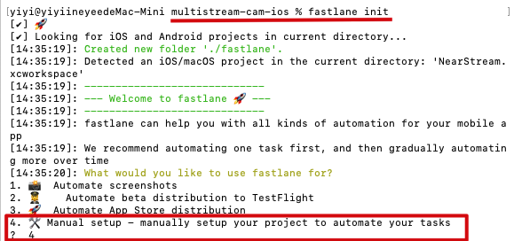
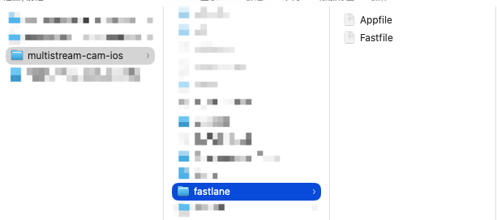
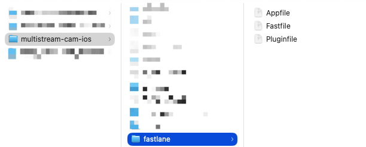
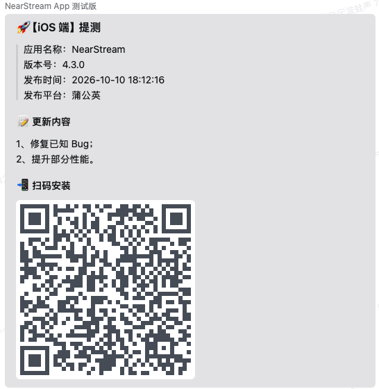
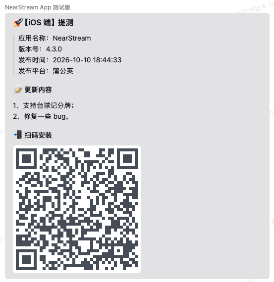

## 一、配置企微群聊消息推送

我们希望在打包提测后能自动往企微群里推送一条消息通知相关人员，而不用每次人工通知。

#### 1、获取企微群聊消息推送的 Webhook 地址

* 打开企微

* 打开某个群聊

* 点击右上角的群聊设置

* 找到消息推送

* 添加消息推送

* 复制它的 Webhook 地址


#### 2、验证能否通过 Webhook 地址给企微群聊推送消息

终端执行以下命令验证

```shell
curl '你的 Webhook 地址' \
  -H 'Content-Type: application/json' \
  -d '{
    "msgtype": "text",
    "text": {
      "content": "Fastlane 自动发布通知测试成功！"
    }
  }'
```

执行后，企微群聊成功收到推送


## 二、安装 fastlane

终端执行以下命令安装 fastlane

```shell
brew install fastlane
```

终端执行以下命令查看 fastlane 版本

```shellshell
fastlane --version
```

## 三、配置 fastlane

#### 1、初始化 fastlane

cd 到项目根目录，终端执行以下命令初始化 fastlane

```shell
fastlane init
```

这里选择 Manual setup，一路敲回车



执行结束后，项目根目录下会自动生成一个 fastlane 文件夹



#### 2、编辑 fastlane 文件

```ruby
#------ Appfile ------#

# ============================== 
# 1、App 的 Bundle ID
# 哪里找？TARGETS → Signing & Capabilities → Bundle Identifier
# ============================== 
app_identifier("com.auditoryworks.nearstreams")

# ==============================
# 2、Apple Developer 团队 ID
# 哪里找？登录 Apple Developer 网站：Account → Membership Details → Team ID（10 位的字母数字组合）
# ============================== 
team_id("8C2WJTL66R")
```

```ruby
#------ Fastfile ------#
# 不同项目需要修改【项目基础配置】的以下内容：
# 1、Xxx.xcworkspace：就是我们用 Xcode 打开项目时的那个文件名
# 2、SCHEME_NAME：通常跟 Xxx 是一样的
# 3、IPA_NAME：跟 Xxx 一样即可
# 4、PGYER_API_KEY：登录蒲公英 > 账号 > API 信息 > API Key
# 5、WECOM_WEBHOOK：企业微信群机器人 Webhook 地址
# 6、TESTER_MOBILES：需要 @ 的人员手机号

default_platform(:ios)

platform :ios do
  # ==============================
  # 1、项目基础配置
  # ==============================

  # 项目根目录
  PROJECT_ROOT = File.expand_path("..", __dir__)

  # 工作空间路径
  WORKSPACE_PATH = File.join(
    PROJECT_ROOT,
    "NearStream.xcworkspace"
  )

  # SCHEME_NAME
  SCHEME_NAME = "NearStream"

  # 打包产物输出目录
  OUTPUT_DIR = File.join(
    PROJECT_ROOT,
    "build",
    "ios"
  )

  # 打包产物名称
  IPA_NAME = "NearStream.ipa"

  # 打包产物输出路径
  IPA_PATH = File.join(
    OUTPUT_DIR,
    IPA_NAME
  )

  # PGYER_API_KEY
  PGYER_API_KEY = "99d5f2bd5fca6f06478425d427613e74"

  # 企微群聊消息推送的 Webhook 地址
  WECOM_WEBHOOK = "https://qyapi.weixin.qq.com/cgi-bin/webhook/send?key=01c7f32c-525e-4540-96e4-6c8dda8ac4bb"

  # 需要 @ 的人员手机号
  TESTER_MOBILES = [
    "手机号 1",
    "手机号 2"
  ]


  # ==============================
  # 2、打包 IPA
  # ==============================

  # 描述一下 fastlane 正在做什么
  desc "Build iOS IPA"

  # 将来执行 fastlane build 命令即可开始“打包 IPA”，build 可以自定义成其它字符串
  lane :build do

    # 终端里会打印这条信息
    UI.message("开始构建 iOS 安装包")

    build_app(
      workspace: WORKSPACE_PATH,
      scheme: SCHEME_NAME,
      output_directory: OUTPUT_DIR,
      output_name: IPA_NAME,

      # 打包模式：Release、Debug、Profile
      configuration: "Release",

      # 打什么包：ad-hoc、app-store
      export_method: "ad-hoc",

      # 每次打包之前 clean 一下以前的编译信息
      clean: true,

      # 是否包含bitcode
      include_bitcode: false,

      # 是否包含symbols
      include_symbols: true,

      # 这个设置是为了设置Xcode自动配置证书和配置文件，当然也可以手动配置
      export_xcargs: "-allowProvisioningUpdates"
    )

    UI.success("iOS 打包成功")

    UI.message("IPA 路径：#{IPA_PATH}")

  end


  # ==============================
  # 3、上传 IPA
  # ==============================

  # 描述一下 fastlane 正在做什么
  desc "Upload existing IPA to Pgyer"

  # 将来执行 fastlane upload 命令即可开始“上传 IPA”，upload 可以自定义成其它字符串
  # options 是一个 [String: Any] 类型的 HashMap，我们在终端执行 fastlane upload 可以传递参数进来
  # 例如：fastlane upload releaseNote:"1、修复已知Bug；\n2、提升部分性能。"
  lane :upload do |options|

    # 检查 IPA 是否存在
    unless File.exist?(IPA_PATH)
      UI.user_error!(
        "IPA 不存在：#{IPA_PATH}"
      )
    end

    # 终端里会打印这条信息
    UI.message("开始上传蒲公英")

    # 获取更新说明
    release_note = (
      options[:releaseNote] || "iOS 测试版本"
    ).gsub('\n', "  \n")

    result = pgyer(
      api_key: PGYER_API_KEY,
      ipa: IPA_PATH,
      update_description: release_note
    )

    UI.success("蒲公英上传成功")

    # 检查上传结果
    unless result.is_a?(Hash)
      UI.user_error!("蒲公英未返回有效的上传结果")
    end

    # 将完整上传结果返回给调用方
    # beta 可以获取下载地址、版本号、Build 号
    result

  end


  # ==============================
  # 4、企微群聊消息推送
  # ==============================

  # 描述一下 fastlane 正在做什么
  desc "Send release notification to WeCom"

  # 将来执行 fastlane notify 命令即可发起企微群聊消息推送
  # 例如：fastlane notify url:"https://www.pgyer.com/xxxx"
  #
  # 支持传入以下参数：
  # platform：发布平台（蒲公英 / App Store）
  # url：下载地址
  # qrcode_url：二维码地址
  # version：App 版本号
  # buildNumber：App Build 号
  # releaseNote：更新内容

  lane :notify do |options|

    # 引入 Ruby 标准库
    require "net/http"
    require "json"
    require "uri"

    # 获取发布平台
    publish_platform = options[:platform] || "蒲公英"

    # 获取二维码地址
    qrcode_url = options[:qrcodeUrl]
    UI.message("二维码地址：#{qrcode_url}")

    # 判断二维码地址是否存在
    qrcode_markdown = if qrcode_url && !qrcode_url.empty?
        ""
    else
        ""
    end

    # 获取版本号
    version = options[:version] || "未知"

    # 获取更新说明
    release_note = (
      options[:releaseNote] || "iOS 测试版本"
    ).gsub('\n', "  \n")

    # 获取发布时间
    publish_time = Time.now.strftime(
      "%Y-%m-%d %H:%M:%S"
    )

    # ------------------------------
    # 构造企业微信 Markdown 消息
    # ------------------------------

    content = <<~MARKDOWN
      ## 🚀【iOS 端】提测

      > 应用名称：#{SCHEME_NAME}
      > 版本号：#{version}
      > 发布时间：#{publish_time}
      > 发布平台：#{publish_platform}

      #### 📝 更新内容

      #{release_note}

      #### 📲 扫码安装

      #{qrcode_markdown}
    MARKDOWN


    # ------------------------------
    # 发送 HTTP 请求
    # ------------------------------

    # 将 Webhook 字符串转为 URI 对象
    uri = URI.parse(WECOM_WEBHOOK)

    # 创建 POST 请求
    request = Net::HTTP::Post.new(uri)

    # 设置请求类型
    request["Content-Type"] = "application/json"

    # 构造请求 Body
    request.body = {
      msgtype: "markdown_v2",
      markdown_v2: {
        content: content
      }
    }.to_json

    # 输出日志
    UI.message("开始发送企业微信群通知")

    # 发送请求
    response = Net::HTTP.start(
      uri.hostname,
      uri.port,
      use_ssl: true,
      open_timeout: 10,
      read_timeout: 15
    ) do |http|

      http.request(request)

    end


    # ------------------------------
    # 检查发送结果
    # ------------------------------

    # 检查 HTTP 状态码
    unless response.is_a?(Net::HTTPSuccess)
      UI.user_error!(
        "企业微信通知失败：HTTP #{response.code}"
      )
    end

    # 解析企业微信返回的数据
    result = JSON.parse(response.body)

    # 判断企业微信是否接收成功
    if result["errcode"] == 0

      UI.success("企业微信群通知发送成功")

    else

      UI.user_error!(
        "企业微信群通知失败：#{result['errmsg']}"
      )

    end


    # ------------------------------
    # @ 指定人员
    # ------------------------------

    # 创建 POST 请求
    mention_request = Net::HTTP::Post.new(uri)

    # 设置请求类型
    mention_request["Content-Type"] = "application/json"

    # 构造请求 Body
    mention_request.body = {
      msgtype: "text",
      text: {
        content: "🚀 【iOS 端】已提测，请及时安装测试。",
        mentioned_mobile_list: TESTER_MOBILES
      }
    }.to_json

    # 输出日志
    UI.message("开始 @ 指定人员")

    # 发送请求
    mention_response = Net::HTTP.start(
      uri.hostname,
      uri.port,
      use_ssl: true,
      open_timeout: 10,
      read_timeout: 15
    ) do |http|

      http.request(mention_request)

    end


    # ------------------------------
    # 检查 @ 通知发送结果
    # ------------------------------

    # 检查 HTTP 状态码
    unless mention_response.is_a?(Net::HTTPSuccess)
      UI.user_error!(
        "企业微信 @ 通知失败：HTTP #{mention_response.code}"
      )
    end

    # 解析企业微信返回的数据
    mention_result = JSON.parse(mention_response.body)

    # 判断企业微信是否接收成功
    if mention_result["errcode"] == 0

      UI.success("企业微信 @ 通知发送成功")

    else

      UI.user_error!(
        "企业微信 @ 通知失败：#{mention_result['errmsg']}"
      )

    end

  end


  # ==============================
  # 5、一键打包 + 上传蒲公英 + 通知企微
  # ==============================

  # 描述一下 fastlane 正在做什么
  desc "Build and upload iOS to Pgyer"

  # 将来执行 fastlane beta 命令即可开始“一键打包并上传”，beta 可以自定义成其它字符串
  lane :beta do |options|

    # ------------------------------
    # 第一步：构建 IPA
    # ------------------------------
    build


    # ------------------------------
    # 第二步：上传蒲公英并获取发布信息
    # ------------------------------

    # 接收 upload 返回的完整上传结果
    result = upload(
      ipa: IPA_PATH,
      releaseNote: options[:releaseNote]
    )


    # ------------------------------
    # 第三步：发送企业微信通知
    # ------------------------------

    # 获取二维码图片地址
    qrcode_url = result["buildQRCodeURL"]

    # 获取 App 版本号
    version = result["buildVersion"] || "未知"

    notify(
      platform: "蒲公英",
      qrcodeUrl: qrcode_url,
      version: version,
      releaseNote: options[:releaseNote]
    )


    # ------------------------------
    # 第四步：完成
    # ------------------------------

    UI.success("iOS 自动打包发布完成")

  end

end
```

#### 3、安装蒲公英 fastlane 插件

终端执行以下命令安装蒲公英 fastlane 插件

```shell
fastlane add_plugin pgyer
```

执行结束后，fastlane 文件夹下会自动生成一个 Pluginfile 文件，我们不需要动这个文件



#### 4、验证能否通过终端一键打包 + 上传蒲公英 + 通知企微

终端执行以下命令验证

```shell
fastlane beta releaseNote:"1、修复已知 Bug；\n2、提升部分性能。"
```

执行后，企微群聊成功收到推送



## 四、Codex 里发起一键打包 + 上传蒲公英 + 通知企微

我们编写了一个 pgyer-ios Skill，以便直接在 Codex 里通过显示调用或意图识别的方式触发这个 Skill 来发起一键打包 + 上传蒲公英 + 通知企微，而不用每次都去终端里敲命令。


企微群聊成功收到推送


